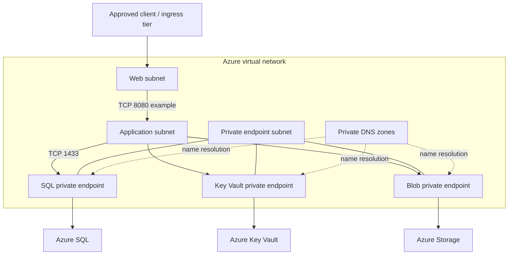

<div align="center">


### Segmented networking · Private PaaS · Identity-aware access

[](https://azure.microsoft.com/)
[](https://developer.hashicorp.com/terraform)
[](https://learn.microsoft.com/azure/architecture/framework/security/)

**An enterprise-style Azure reference architecture for separating web, application and data tiers while keeping platform services on private network paths.**

[Architecture](#-reference-architecture) · [Security boundaries](#-security-boundaries) · [Quick start](#-validate-the-terraform) · [Runbooks](docs/README.md)

</div>

> [!IMPORTANT]
> This is a Terraform reference lab, not a deployed production system. The architecture illustrates intended resource relationships; validate the Terraform plan, DNS, routing, identity and service connectivity in a non-production subscription before use.

## Design objective

A three-tier application should not rely on a single flat network or public access to every dependency. This lab separates ingress, application and data paths, and uses Private Endpoints for selected Azure PaaS services.

## Reference architecture



## Implemented infrastructure patterns

| Area | Included configuration |
|---|---|
| Network segmentation | Web, application, database and private-endpoint subnets |
| Network security | Dedicated NSGs and subnet associations |
| Web-to-app flow | Example TCP/8080 rule |
| App-to-data flow | Example TCP/1433 rule with restrictive rules around the data tier |
| Key Vault | RBAC authorization, private access, soft delete and purge protection |
| Azure SQL | Public network access disabled, Private Endpoint and private DNS |
| Storage | HTTPS/TLS 1.2, shared-key access disabled, public access disabled, private blob endpoint/DNS |
| Naming | Random suffixes for globally scoped resource names |
| CI | Terraform formatting, backend-free initialization and validation |

## Security boundaries and design caveats

- The sample web subnet is **not** directly exposed to the Internet. Add a reviewed Application Gateway, Front Door or other approved ingress tier before serving external traffic.
- TCP/8080 is an example application contract; change it to the actual listener once the workload is implemented.
- Private Endpoints require correct private DNS resolution and a valid client route. A created endpoint alone does not prove connectivity.
- Key Vault network reachability and RBAC authorization are independent controls. Assign workload roles narrowly.
- The Linux VM, load balancer, Front Door and monitoring resources are separate building blocks; their presence does not automatically create a complete end-to-end service.
- Resource SKUs, region support, quotas and cost must be checked before applying.

## Validate the Terraform

Prerequisites: Terraform CLI 1.6+, Azure CLI authenticated to a non-production subscription, permissions for the configured resource types, an SSH public key and a SQL administrator password supplied securely.

```bash
terraform -chdir=terraform fmt -check -recursive
terraform -chdir=terraform init -backend=false
terraform -chdir=terraform validate
terraform -chdir=terraform plan
```

For PowerShell, supply the SQL password only for the current process:

```powershell
$secure = Read-Host "SQL admin password" -AsSecureString
$env:TF_VAR_sql_admin_password = [System.Net.NetworkCredential]::new("", $secure).Password
terraform -chdir=terraform plan
Remove-Item Env:TF_VAR_sql_admin_password
```

Review the full plan, resource SKUs and estimated cost before any apply. Never commit state, plan files, private keys, credentials or real `terraform.tfvars`.

## CI and evidence

GitHub Actions runs formatting, backend-free initialization, validation and an advisory Checkov scan on relevant changes. Static validation checks configuration; it does not prove Azure deployment, private DNS resolution, network reachability or application health. Review the [Actions history](../../actions) for the latest run.

## Repository navigation

- [Architecture and interview guide](docs/README.md)
- [Zero-to-hero walkthrough](docs/ZERO-TO-HERO.md)
- [Advanced interview bank](docs/ADVANCED-INTERVIEW-BANK.md)
- [Terraform source walkthrough](docs/SOURCE-CODE-WALKTHROUGH.md)

## Maintainer

**MD Amirul Haque** · [GitHub](https://github.com/haqueamir70-coder) · [LinkedIn](https://www.linkedin.com/in/md-amirul-haque/)

<sub>Segment trust zones. Keep dependencies private. Validate the complete path.</sub>
