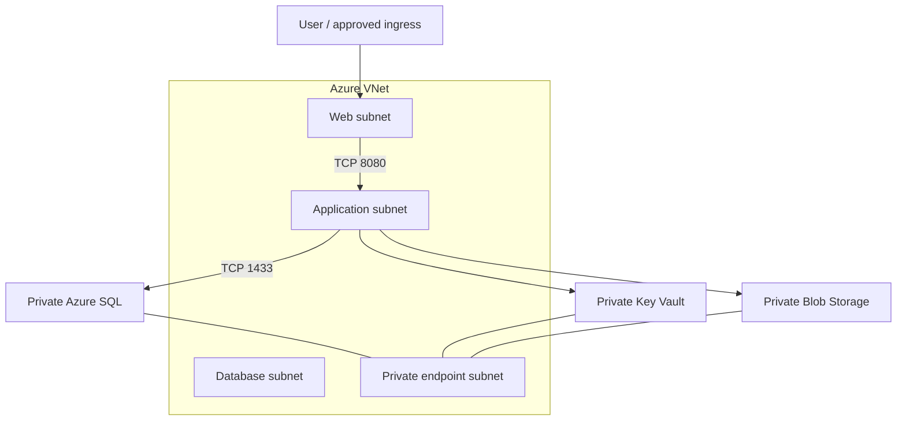

# Azure Enterprise 3-Tier Architecture

> **Status:** Terraform reference lab with segmented web/app/database networks, private endpoint integrations, Key Vault RBAC, private SQL/Storage access and CI validation. It is not represented as a deployed production system.

## Architecture



## Implemented configuration

- Separate web, application, database and private-endpoint subnets.
- Dedicated NSGs and subnet associations.
- Web-to-app rule on TCP/8080 and app-to-SQL rule on TCP/1433, with explicit deny rules for other VNet sources at the app/database tiers.
- Private Key Vault with RBAC authorization, 90-day soft delete, purge protection, default-deny network ACLs and Private Endpoint/DNS.
- Azure SQL public network access disabled with private endpoint and private DNS; the broad 0.0.0.0 Azure-services firewall exception has been removed.
- Storage account with HTTPS/TLS 1.2, shared-key access disabled, public network access disabled and private blob endpoint/DNS.
- Random suffix for globally scoped Key Vault, SQL server and Storage account names.
- Terraform formatting and backend-free validation in GitHub Actions.

## Important design boundaries

- Web ingress is not exposed directly to the Internet by the sample NSG rules. Add and validate an Application Gateway, Front Door or other approved ingress tier before serving external traffic.
- App-to-web port 8080 is an example contract. Change it to the actual application listener after the service is implemented.
- SQL and Storage private endpoints require private DNS resolution and a valid client route from the VNet.
- Key Vault network reachability and RBAC authorization are independent controls. Create narrowly scoped role assignments for actual workloads.
- The Linux VM, load balancer, Front Door and monitoring resources are separate examples and do not by themselves constitute a complete end-to-end service path.
- Azure resources may incur charges. Validate region/SKU availability, quotas, naming and costs before applying.

## Prerequisites

- Terraform CLI 1.6+
- Azure CLI authenticated to a test subscription
- Permission to create networking, VM, SQL, Key Vault, Storage, private endpoint and DNS resources
- A valid SSH public key
- A SQL administrator password supplied securely

## Validate

From the repository root:

```bash
terraform -chdir=terraform fmt -check -recursive
terraform -chdir=terraform init -backend=false
terraform -chdir=terraform validate
terraform -chdir=terraform plan
```

For PowerShell, set the SQL password only in the current process:

```powershell
$secure = Read-Host "SQL admin password" -AsSecureString
$env:TF_VAR_sql_admin_password = [System.Net.NetworkCredential]::new("", $secure).Password
terraform -chdir=terraform plan
Remove-Item Env:TF_VAR_sql_admin_password
```

Review the full plan and cost before any apply. Do not commit Terraform state, plan files, private keys, credentials or real terraform.tfvars.

## CI

GitHub Actions runs formatting, backend-free initialization, Terraform validation and an advisory Checkov scan on relevant pull requests and pushes. Triage Checkov findings before treating the scan as a blocking security gate. A passing CI run validates configuration syntax, not Azure deployment success or runtime connectivity.

## Author

MD Amirul Haque · [GitHub profile](https://github.com/haqueamir70-coder) · [LinkedIn](https://www.linkedin.com/in/md-amirul-haque/)


## Architecture and interview preparation

See the [architecture diagram and interview questions](docs/README.md) for the repository-specific design walkthrough and technical interview guide.
