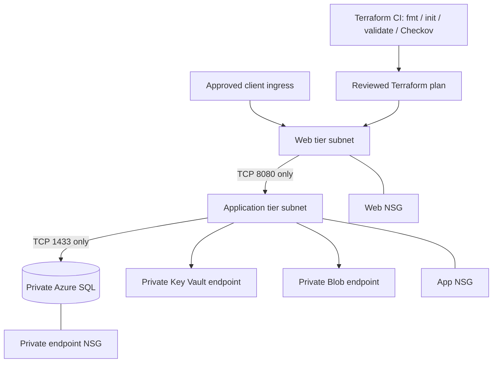

# Azure enterprise 3-tier architecture — Architecture & Interview Guide

Reference design for segmented web, application and data tiers. Validate ingress implementation, private DNS resolution and subnet/NSG rules in the target subscription before deployment.

## Architecture diagram

## Interview questions

1. 1. Why separate web, application and data tiers?
2. 2. How do NSGs differ from Azure Firewall?
3. 3. Why should app-to-database traffic be restricted to TCP 1433?
4. 4. What is the role of a private endpoint and private DNS zone?
5. 5. How would you implement public web ingress safely?
6. 6. Why disable SQL and Storage public network access?
7. 7. How do you prevent accidental exposure through NSG priority rules?
8. 8. What are the risks of broad VirtualNetwork service tags?
9. 9. How would you test private DNS resolution from the application subnet?
10. 10. What is the safe process for applying a production network change?

## Interview preparation note
For each answer, cover the design rationale, trust boundary, failure mode, operational telemetry and validation method. Distinguish implemented, CI-validated, cloud-deployed and planned capabilities.
