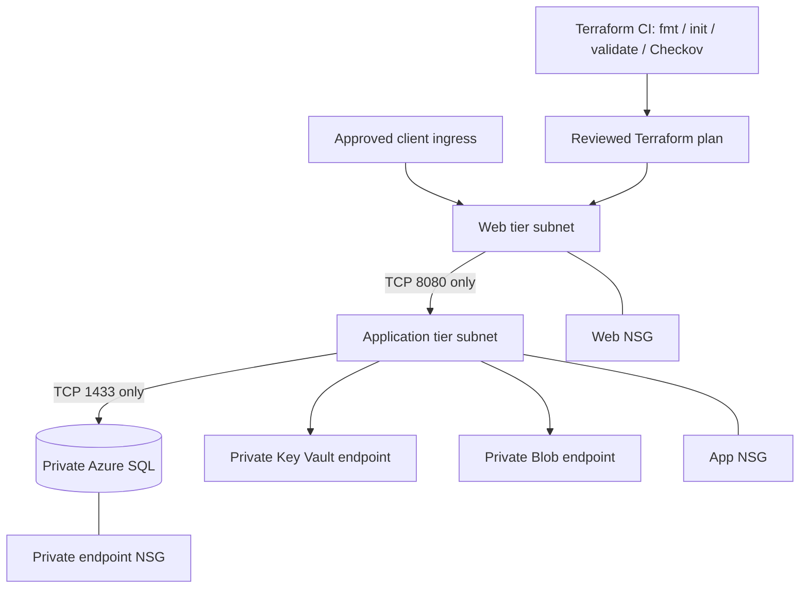

# Azure enterprise 3-tier architecture — Architecture & Interview Guide

Reference design for segmented web, application and data tiers. Validate ingress implementation, private DNS resolution and subnet/NSG rules in the target subscription before deployment.

## Architecture diagram

## Interview questions

1. 1. Why separate web, application and data tiers?
2. 2. How do NSGs differ from Azure Firewall?
3. 3. Why should app-to-database traffic be restricted to TCP 1433?
4. 4. What is the role of a private endpoint and private DNS zone?
5. 5. How would you implement public web ingress safely?
6. 6. Why disable SQL and Storage public network access?
7. 7. How do you prevent accidental exposure through NSG priority rules?
8. 8. What are the risks of broad VirtualNetwork service tags?
9. 9. How would you test private DNS resolution from the application subnet?
10. 10. What is the safe process for applying a production network change?

## Interview preparation note
For each answer, cover the design rationale, trust boundary, failure mode, operational telemetry and validation method. Distinguish implemented, CI-validated, cloud-deployed and planned capabilities.

## Interview questions — suggested answers

### 1. Answer

Separate tiers reduce blast radius and let each layer expose only required interfaces. Web handles ingress, app owns business logic, and data tier is not directly reachable by clients.

### 2. Answer

NSGs are distributed L3/L4 filters on NICs/subnets; Azure Firewall is a centralized stateful network security service with richer inspection, logging and egress control.

### 3. Answer

Allowing only TCP 1433 from the application tier limits SQL reachability to the expected protocol and source. Use private connectivity and database identity controls as well.

### 4. Answer

A private endpoint gives a service a private IP in the VNet. Private DNS maps the service's normal hostname to that IP so clients resolve to the private route.

### 5. Answer

Use an approved ingress such as Application Gateway/WAF or Front Door with controlled origin access, TLS, health probes, WAF policy and explicit routing. The repository's ingress must be verified before claiming it is implemented.

### 6. Answer

Public access disabled limits service exposure to private paths. Shared Key disabled reduces reliance on account keys and encourages Entra identity/RBAC.

### 7. Answer

Review effective NSG rules and priorities, avoid broad Any rules, test from representative subnets and ensure deny rules do not accidentally block required platform traffic.

### 8. Answer

VirtualNetwork can include connected networks and peered address spaces, so it may be broader than one subnet. Use explicit prefixes or ASGs where tighter scope is required.

### 9. Answer

From a test VM/pod, query the service FQDN, inspect the resolved private IP, verify route/NSG path and perform an authenticated connection test; also confirm public resolution/access is blocked.

### 10. Answer

Use a reviewed plan, staged change, maintenance window if needed, baseline connectivity tests, rollback plan and post-change verification. Never apply a broad network change blindly.

## Complete zero-to-hero guide

See [ZERO-TO-HERO.md](./ZERO-TO-HERO.md) for the business scenario, architecture walkthrough, tool-by-tool explanations, implementation sequence, practical commands, troubleshooting playbook and additional scenario-based interview questions with answers.

## Source-code walkthrough

See [SOURCE-CODE-WALKTHROUGH.md](./SOURCE-CODE-WALKTHROUGH.md) for the actual Terraform file-by-file explanation, code-specific interview questions and implementation gaps found during source review.

## Advanced question bank

See [ADVANCED-INTERVIEW-BANK.md](./ADVANCED-INTERVIEW-BANK.md) for 40 additional project-specific questions and answers.
